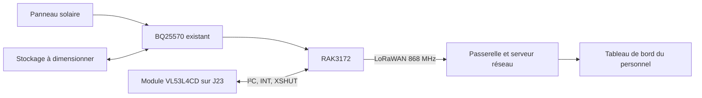

<p align="center"></p>

# VeillePorte — suivi des ouvertures de porte

Projet d’**Amira — [amirabouraoui01-stack](https://github.com/amirabouraoui01-stack)** : concevoir un dispositif pour signaler les ouvertures de porte dans l’accompagnement des personnes atteintes de la **maladie d’Alzheimer**, notamment en milieu hospitalier.

Un module infrarouge de distance VL53L4CD (Pololu 3692), fixé sur le cadre face à une cible sur la porte, permettra de qualifier son état. Le RAK3172 transmettra les changements par **LoRaWAN 868 MHz**. Un tableau de bord permettra au personnel de consulter l’état reçu, l’heure de réception et les événements pendant les horaires de surveillance configurés.

**Révision 0.5 :** l’accéléromètre est remplacé dans le schéma par le raccordement du module VL53L4CD : I²C, interruption directe 2,8 V et commande de veille. Le BQ25570 est réglé pour une supercapacité limitée à 4 V ; voir le guide de dimensionnement. Le PCB de 60 × 30 mm avec accéléromètre est conservé dans `archive_avant_ir/` ; **le PCB de la révision IR reste à réaliser**. Les anciens résultats DRC ne valident pas le nouveau schéma. Aucun programme ou essai physique IR n’est encore réalisé.

Une ouverture ne permet pas de savoir qui passe ni si une personne sort effectivement. Ce prototype pédagogique apporte une information complémentaire au personnel ; aucune prévention de sortie ou surveillance clinique garantie n’est revendiquée.

## Accès au projet

**Antenne :** [étude CST 868 MHz](docs/ANTENNE_CST.md) · [empreinte KiCad locale](docs/EMPREINTE_ANTENNE.md) · [modèles CST et macros](VeillePorte/cst/README.md). L’empreinte IFA est liée aux réseaux RF et masse du schéma complet ; le placement final de la carte et l’intégration au panneau et au boîtier restent à valider.

**Pour voir tous les branchements sur une seule page : ouvrir [veilleporte_complet.kicad_pro](VeillePorte/veilleporte_complet.kicad_pro).** [PDF A2](VeillePorte/veilleporte_complet.pdf) · [Guide de lecture et vérification](docs/SCHEMA_COMPLET.md).

| Pour… | Ouvrir… |
|---|---|
| Modifier dans KiCad 10 | [Projet complet VeillePorte](VeillePorte/veilleporte_complet.kicad_pro) |
| Voir la carte routée | [PCB 60 × 30 mm](VeillePorte/archive_avant_ir/veilleporte.kicad_pcb) · [Règles et contrôles](VeillePorte/PCB.md) |
| Lire le schéma | [PDF — une page A2](VeillePorte/veilleporte_complet.pdf) · [Référence par feuilles](VeillePorte/veilleporte.pdf) |
| Voir les branchements | [Schéma complet](VeillePorte/veilleporte_complet.kicad_sch) |
| Comprendre les connexions | [Architecture](docs/ARCHITECTURE.md) |
| Connaître les validations | [État du projet](docs/ETAT_DU_PROJET.md) |
| Préparer les essais | [Mise en service](docs/MISE_EN_SERVICE.md) |

## Le fonctionnement visé

1. Lire le capteur IR, vérifier la validité des mesures et appliquer deux seuils avec temporisation.
2. Transmettre les transitions ouvert/fermé et un message périodique de présence.
3. Afficher l’état reçu et signaler les ouvertures pendant les horaires configurés.
4. Indiquer un état inconnu lorsque les données deviennent trop anciennes.

[Scénario et limites](docs/VEILLEPORTE.md) · [Spécification de la première version](docs/VERSION_1.md).



## Électronique de VeillePorte

| Bloc | Composant | Fonction |
|---|---|---|
| Traitement et radio | **RAK3172(H)** | I²C2, interruption, UART2, SWD, sortie RF |
| Détection IR | **Module VL53L4CD Pololu 3692** | I²C `0x29`, interruption vers PA1, XSHUT vers PB5 |
| Énergie | **BQ25570** | Récupération d’énergie et sortie buck |
| Liaison radio | **AE1, antenne IFA 868 MHz** | Empreinte cuivre personnalisée issue du modèle CST, réseau RF et masse |
| Surveillance du stockage | **R8/R9** | Adaptation de VBAT_OK vers PA0 |

J23 est un connecteur de câble défini pour ce projet : son ordre de broches ne reproduit pas l’ordre physique du module. Voir [le câblage IR](docs/CAPTEUR_IR.md).

La feuille BQ25570 est désormais adaptée à la demande d’Amira pour une **supercapacité 4 V maximum**. Les options NC et C22 restent conservées. Le fichier original demeure dans l’archive EDU RAK. [Valeurs, hystérésis et limites](docs/ALIMENTATION.md).

## Aperçus du schéma

<table><tr>
<td width="50%" align="center"><a href="VeillePorte/rak3172.kicad_sch"></a><br><strong>Traitement et radio</strong></td>
<td width="50%" align="center"><a href="VeillePorte/capteur_ir.kicad_sch"></a><br><strong>Capteur IR et adaptation</strong></td>
</tr></table>

[Galerie complète](docs/GALERIE.md) · [Documentation électronique](VeillePorte/README.md)

## Ancienne carte routée — avant IR


[Voir le dos, les hypothèses de fabrication et le rapport de contrôle](VeillePorte/PCB.md).

## Organisation

```text
EDU_RAK_2026/
├── README.md                 # VeillePorte — projet d’Amira
├── CREDITS.md                # Origine et inspirations
├── CHANGELOG.md              # Évolution du projet
├── VeillePorte/            # Projet actif, PDF et rapport ERC
├── docs/                     # Architecture, avancement et essais
│   └── assets/               # Bannière et aperçus réels des schémas
├── tools/                    # Vérification reproductible des fichiers
└── references/EDU_RAK_2026/   # Ressources pédagogiques originales
    ├── Hardware/
    ├── Datasheets/
    └── Formation_Kicad/
```

## Reprendre le travail

1. Cloner : `git clone https://github.com/amirabouraoui01-stack/EDU_RAK_2026.git`.
2. Ouvrir `VeillePorte/veilleporte_complet.kicad_pro` avec **KiCad 10** pour la vue unique et ses branchements.
3. Consulter les feuilles, le PDF et [les contrôles](docs/ETAT_DU_PROJET.md).
4. Confirmer la source d’énergie, le stockage et les contraintes de fabrication, puis valider le montage sur banc.

Le nom historique du dépôt est conservé pour garder son adresse GitHub. Le projet actif et cette page sont dédiés à VeillePorte. Les anciens PCB et photos dans `references/` décrivent EDU RAK ; ils ne représentent pas une carte VeillePorte fabriquée.

L’autonomie, la portée et la détection des ouvertures restent à mesurer. Le projet actuel ne comprend pas de GPS. [Crédits et sources](CREDITS.md).


Le projet actif se trouve désormais dans `VeillePorte/`, avec les fichiers principaux `veilleporte.*`. Le schéma 0.5 inclut les nouveaux réglages ; le PCB IR reste à réaliser.

La version active de l’antenne utilise une [piste fine sans plaque](VeillePorte/cst/veilleporte_868_piste_basse.cst), avec un S11 simulé d’environ −12 dB à 868 MHz et un moniteur de farfield configuré à 868 MHz. L’image du diagramme de rayonnement reste à exporter depuis CST. L’empreinte est assignée à AE1 dans le schéma complet ; le PCB reste à placer et à router.
