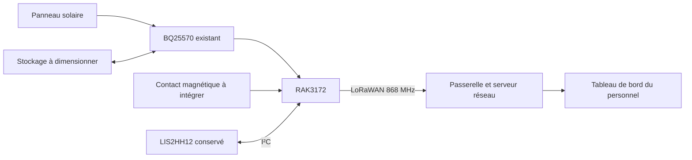

<p align="center"></p>

# VeillePorte — suivi des ouvertures de porte

Projet d’**Amira — [amirabouraoui01-stack](https://github.com/amirabouraoui01-stack)** : concevoir un dispositif pour signaler les ouvertures de porte dans l’accompagnement des personnes atteintes de la **maladie d’Alzheimer**, notamment en milieu hospitalier.

Un contact magnétique placé sur la porte et son cadre indiquera l’état ouvert ou fermé. Le RAK3172 transmettra les changements par **LoRaWAN 868 MHz**. Un tableau de bord permettra au personnel de consulter l’état reçu, l’heure de réception et les événements pendant les horaires de surveillance configurés.

**État au 26 octobre 2026 :** la base KiCad existante contient 47 composants sur un PCB routé de 60 × 30 mm. Le contact magnétique n’est pas encore intégré au schéma ni au PCB ; le firmware, le tableau de bord, l’antenne réelle et le boîtier restent à réaliser. Les rapports existants (0 violation DRC, 0 connexion manquante, 0 problème de parité) concernent uniquement cette base, pas un dispositif VeillePorte terminé.

Une ouverture ne permet pas de savoir qui passe ni si une personne sort effectivement. Ce prototype pédagogique apporte une information complémentaire au personnel ; aucune prévention de sortie ou surveillance clinique garantie n’est revendiquée.

## Accès au projet

| Pour… | Ouvrir… |
|---|---|
| Modifier dans KiCad 10 | [Projet VeillePorte](VeillePorte/veilleporte.kicad_pro) |
| Voir la carte routée | [PCB 60 × 30 mm](VeillePorte/veilleporte.kicad_pcb) · [Règles et contrôles](VeillePorte/PCB.md) |
| Lire le schéma | [PDF complet — quatre pages](VeillePorte/veilleporte.pdf) |
| Explorer les feuilles | [Schéma principal](VeillePorte/veilleporte.kicad_sch) |
| Comprendre les connexions | [Architecture](docs/ARCHITECTURE.md) |
| Connaître les validations | [État du projet](docs/ETAT_DU_PROJET.md) |
| Préparer les essais | [Mise en service](docs/MISE_EN_SERVICE.md) |

## Le fonctionnement visé

1. Lire le contact magnétique et filtrer ses rebonds.
2. Transmettre les transitions ouvert/fermé et un message périodique de présence.
3. Afficher l’état reçu et signaler les ouvertures pendant les horaires configurés.
4. Indiquer un état inconnu lorsque les données deviennent trop anciennes.

[Scénario et limites](docs/VEILLEPORTE.md) · [Spécification de la première version](docs/VERSION_1.md).



## Électronique de VeillePorte

| Bloc | Composant | Fonction |
|---|---|---|
| Traitement et radio | **RAK3172(H)** | I²C2, interruption, UART2, SWD, sortie RF |
| Accéléromètre conservé, optionnel | **LIS2HH12** | Adresse I²C `0x1E`, INT1 vers PA1 |
| Énergie | **BQ25570** | Récupération d’énergie et sortie buck |
| Liaison radio | **AE1, antenne générique 868 MHz** | Représentation d’une antenne externe, modèle à choisir |
| Surveillance du stockage | **R8/R9** | Adaptation de VBAT_OK vers PA0 |

Le contact magnétique et son entrée GPIO restent à choisir et à intégrer. L’accéléromètre est conservé mais n’est pas nécessaire à la détection d’ouverture.

La feuille BQ25570 est une **copie exacte du fichier pédagogique d’origine**. Les résistances NC et **C22** sont conservées sans correction. Le raccordement externe d’EN à la masse se fait sur la feuille RAK3172 ; le fichier BQ reste inchangé.

## Aperçus du schéma

<table><tr>
<td width="50%" align="center"><a href="VeillePorte/rak3172.kicad_sch"></a><br><strong>Traitement et radio</strong></td>
<td width="50%" align="center"><a href="VeillePorte/accelerometre.kicad_sch"></a><br><strong>Accélération sur trois axes</strong></td>
</tr></table>

[Galerie complète](docs/GALERIE.md) · [Documentation électronique](VeillePorte/README.md)

## Carte routée


[Voir le dos, les hypothèses de fabrication et le rapport de contrôle](VeillePorte/PCB.md).

## Organisation

```text
EDU_RAK_2026/
├── README.md                 # VeillePorte — projet d’Amira
├── CREDITS.md                # Origine et inspirations
├── CHANGELOG.md              # Évolution du projet
├── VeillePorte/            # Projet actif, PDF et rapport ERC
├── docs/                     # Architecture, avancement et essais
│   └── assets/               # Bannière et aperçus réels des schémas
├── tools/                    # Vérification reproductible des fichiers
└── references/EDU_RAK_2026/   # Ressources pédagogiques originales
    ├── Hardware/
    ├── Datasheets/
    └── Formation_Kicad/
```

## Reprendre le travail

1. Cloner : `git clone https://github.com/amirabouraoui01-stack/EDU_RAK_2026.git`.
2. Ouvrir `VeillePorte/veilleporte.kicad_pro` avec **KiCad 10**.
3. Consulter les feuilles, le PDF et [les contrôles](docs/ETAT_DU_PROJET.md).
4. Confirmer la source d’énergie, le stockage et les contraintes de fabrication, puis valider le montage sur banc.

Le nom historique du dépôt est conservé pour garder son adresse GitHub. Le projet actif et cette page sont dédiés à VeillePorte. Les anciens PCB et photos dans `references/` décrivent EDU RAK ; ils ne représentent pas une carte VeillePorte fabriquée.

L’autonomie, la portée et la détection des ouvertures restent à mesurer. Le projet actuel ne comprend pas de GPS. [Crédits et sources](CREDITS.md).


Le projet actif se trouve désormais dans `VeillePorte/`, avec les fichiers principaux `veilleporte.*`. Le circuit reste identique ; le contact magnétique reste à intégrer.
