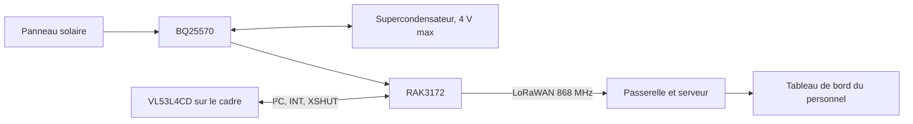

# VeillePorte

Projet d’Amira : concevoir un dispositif pédagogique qui signale l’état ouvert ou fermé d’une porte dans l’accompagnement de personnes atteintes de la maladie d’Alzheimer. Le capteur infrarouge mesure la distance à une cible fixée sur la porte. Le RAK3172 transmet l’état par LoRaWAN 868 MHz.

Le système ne reconnaît personne, n’identifie pas le sens de passage et ne prouve pas qu’une personne est sortie. Il complète l’information disponible pour le personnel ; il ne remplace pas l’accompagnement humain.

## Fichier de conception retenu

Ouvrir **[le projet KiCad VeillePorte](VeillePorte/veilleporte_complet.kicad_pro)**. Le schéma A2, son PDF, sa netlist et son rapport ERC sont dans le même dossier. Le projet utilise les bibliothèques locales de symboles et d’empreintes.

| Fonction | Composant / raccordement |
|---|---|
| Microcontrôleur et LoRaWAN | RAK3172(H), bande 868 MHz |
| Détection de porte | Module VL53L4CD Pololu 3692, relié par J23 |
| Récupération d’énergie | BQ25570, réglé pour un stockage limité à 4 V |
| Antenne | IFA imprimée 868 MHz, empreinte KiCad liée à RF et masse |
| Interface | UART2, SWD, reset et BOOT0 |

J23 est le brochage du câble du projet, pas l’ordre physique des pastilles du module. Voir le [câblage du capteur](docs/CAPTEUR_IR.md). Les composants NC et C22 de la feuille BQ sont conservés. Le schéma BQ original reste dans l’archive EDU RAK sous references/.

## État actuel

- Schéma : 47 composants ; 0 erreur ERC et 3 avertissements documentés.
- PCB routé : 40 × 60 mm, quatre couches, 1,6 mm ; plan GND sur In2.Cu, 19 vias GND et perçages de vias de 0,3 mm minimum.
- Contrôle PCB et concordance avec le schéma : **0 erreur, 0 avertissement et 0 connexion manquante**.
- [Vues 3D et STEP](VeillePorte/README.md#vues-et-exports) disponibles ; versions précédentes conservées dans [archives](archives/README.md).
- Antenne : géométrie CST conservée, zone 30 × 20 mm. Accord à 868 MHz à revalider sur le PCB de 1,6 mm et dans le boîtier ; le résultat CST historique ne valide pas cette nouvelle carte.
- Firmware, mesures d’autonomie et essais radio sur prototype : à réaliser.

La carte routée de l’ancienne version accéléromètre n’est pas une carte VeillePorte et n’est plus présentée comme version courante. Aucun prototype n’a été validé sur banc.

## Documents du projet final

- [Architecture et limites](docs/ARCHITECTURE.md)
- [Spécification fonctionnelle](docs/VEILLEPORTE.md)
- [Alimentation BQ25570](docs/ALIMENTATION.md)
- [Capteur IR et câble J23](docs/CAPTEUR_IR.md)
- [Antenne CST et intégration](docs/ANTENNE_CST.md)
- [Empreinte KiCad de l’antenne](docs/EMPREINTE_ANTENNE.md)
- [État et validations](docs/ETAT_DU_PROJET.md)
- [Préparation des essais](docs/MISE_EN_SERVICE.md)

## Chaîne fonctionnelle

## Reprendre le projet

1. Cloner https://github.com/amirabouraoui01-stack/EDU_RAK_2026.git.
2. Ouvrir VeillePorte/veilleporte_complet.kicad_pro avec KiCad 10.
3. Consulter le [PDF A2](VeillePorte/veilleporte_complet.pdf) ou le [rapport ERC](VeillePorte/erc_complet.json).
4. Examiner le PCB routé, ses vues 3D et ses rapports ; revalider la radio sur l’empilage réel avant fabrication, puis réaliser les essais sur banc.

L’archive references/EDU_RAK_2026/ conserve les documents pédagogiques d’origine, dont le BQ25570 source. Elle n’est pas une seconde version du projet actif.

