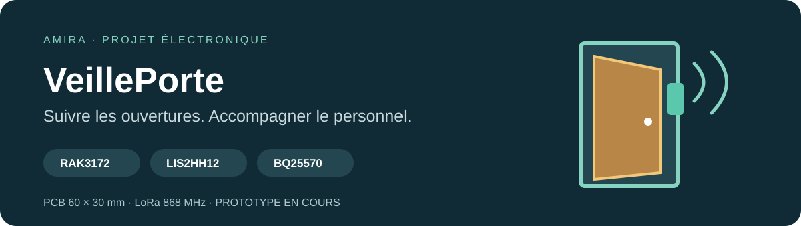
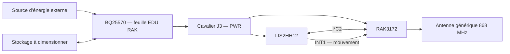
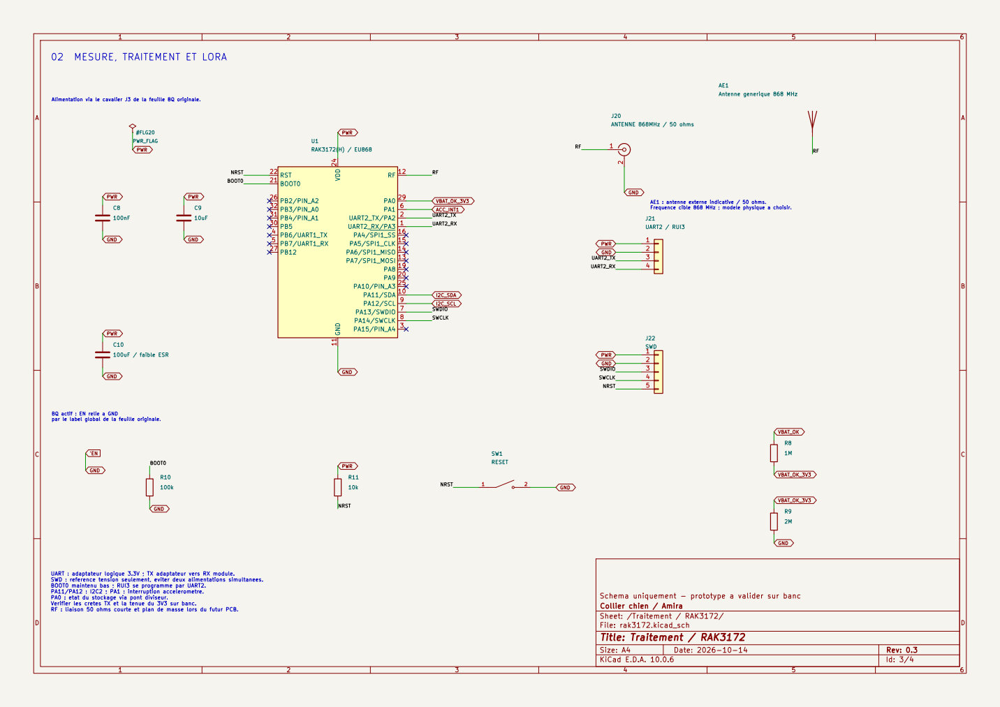
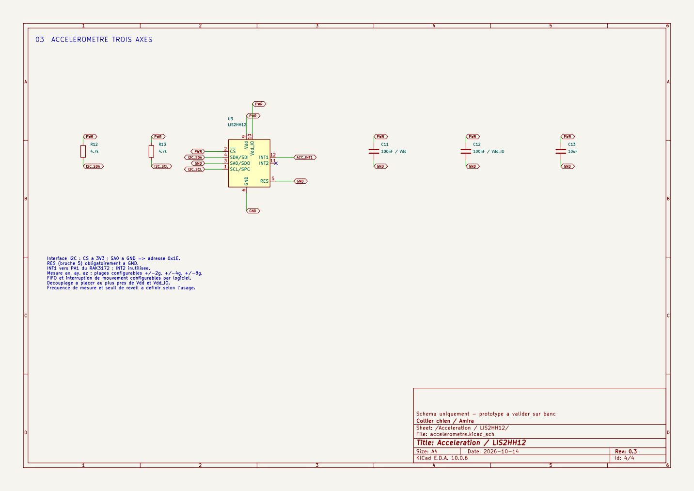

<p align="center"></p>

# Collier connecté — accélération et LoRa

Projet personnel d’**Amira — [amirabouraoui01-stack](https://github.com/amirabouraoui01-stack)** : concevoir l’électronique d’un collier pour chien qui mesure les mouvements sur trois axes, puis prépare leur transmission radio avec un **RAK3172**.

**État au 14 octobre 2026 :** schéma KiCad disponible, accéléromètre LIS2HH12 raccordé, antenne générique 868 MHz représentée et feuille BQ25570 d’EDU RAK conservée à l’identique. Le PCB, le boîtier, le firmware et les essais ne sont pas encore réalisés.

## Accès au projet

| Pour… | Ouvrir… |
|---|---|
| Modifier dans KiCad 10 | [Projet du collier](Collier_Chien/collier_chien.kicad_pro) |
| Lire le schéma | [PDF complet — quatre pages](Collier_Chien/collier_chien.pdf) |
| Explorer les feuilles | [Schéma principal](Collier_Chien/collier_chien.kicad_sch) |
| Comprendre les connexions | [Architecture](docs/ARCHITECTURE.md) |
| Connaître les validations | [État du projet](docs/ETAT_DU_PROJET.md) |
| Préparer les essais | [Mise en service](docs/MISE_EN_SERVICE.md) |

## Le fonctionnement visé

Le **LIS2HH12** fournit les accélérations `ax`, `ay`, `az`. Le **RAK3172** pourra lire ces mesures, exploiter l’interruption de mouvement et transmettre des données par LoRa. Cette séquence reste à développer dans le firmware.



## Électronique du collier

| Bloc | Composant | Fonction |
|---|---|---|
| Traitement et radio | **RAK3172(H)** | I²C2, interruption, UART2, SWD, sortie RF |
| Accélération XYZ | **LIS2HH12** | Adresse I²C `0x1E`, INT1 vers PA1 |
| Énergie | **BQ25570** | Récupération d’énergie et sortie buck |
| Liaison radio | **AE1, antenne générique 868 MHz** | Représentation d’une antenne externe, modèle à choisir |
| Surveillance du stockage | **R8/R9** | Adaptation de VBAT_OK vers PA0 |

La feuille BQ25570 est une **copie exacte du fichier pédagogique d’origine**. Les résistances NC et **C22** sont conservées sans correction. Le raccordement externe d’EN à la masse se fait sur la feuille RAK3172 ; le fichier BQ reste inchangé.

## Aperçus du schéma

<table><tr>
<td width="50%" align="center"><a href="Collier_Chien/rak3172.kicad_sch"></a><br><strong>Traitement et radio</strong></td>
<td width="50%" align="center"><a href="Collier_Chien/accelerometre.kicad_sch"></a><br><strong>Accélération sur trois axes</strong></td>
</tr></table>

[Galerie complète](docs/GALERIE.md) · [Documentation électronique](Collier_Chien/README.md)

## Organisation

```text
EDU_RAK_2026/
├── README.md                 # Collier connecté d’Amira
├── CREDITS.md                # Origine et inspirations
├── CHANGELOG.md              # Évolution du projet
├── Collier_Chien/            # Projet actif, PDF et rapport ERC
├── docs/                     # Architecture, avancement et essais
│   └── assets/               # Bannière et aperçus réels des schémas
├── tools/                    # Vérification reproductible des fichiers
└── references/EDU_RAK_2026/   # Ressources pédagogiques originales
    ├── Hardware/
    ├── Datasheets/
    └── Formation_Kicad/
```

## Reprendre le travail

1. Cloner : `git clone https://github.com/amirabouraoui01-stack/EDU_RAK_2026.git`.
2. Ouvrir `Collier_Chien/collier_chien.kicad_pro` avec **KiCad 10**.
3. Consulter les feuilles, le PDF et [les contrôles](docs/ETAT_DU_PROJET.md).
4. Définir la source d’énergie et le stockage, puis valider le montage sur banc avant le PCB.

Le nom historique du dépôt est conservé pour garder son adresse GitHub. Le projet actif et cette page sont dédiés au collier. Les anciens PCB et photos dans `references/` décrivent EDU RAK ; ils ne représentent pas une carte de collier fabriquée.

L’autonomie, la portée et la classification de l’activité restent à mesurer. Le projet actuel ne comprend pas de GPS. [Crédits et sources](CREDITS.md).
