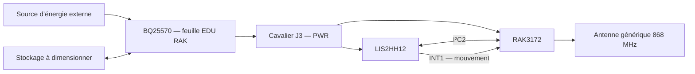

<p align="center"></p>

# ColisCare — suivi des chocs pour colis fragiles

Projet personnel d’**Amira — [amirabouraoui01-stack](https://github.com/amirabouraoui01-stack)** : développer un boîtier placé dans un colis fragile pour détecter les chocs sur trois axes et préparer leur transmission radio avec un **RAK3172**.

**État au 26 octobre 2026 :** schéma et **PCB routé de 60 × 30 mm**, avec **47 composants**, deux couches et un plan de masse. Contrôle KiCad : **0 violation DRC, 0 connexion manquante, 0 problème de parité**. L’antenne est externe, pour 868 MHz, et la feuille BQ25570 d’EDU RAK reste identique à l’original. Les essais, le firmware, le boîtier et la validation de fabrication restent à réaliser.

## Accès au projet

| Pour… | Ouvrir… |
|---|---|
| Modifier dans KiCad 10 | [Projet ColisCare](Collier_Chien/collier_chien.kicad_pro) |
| Voir la carte routée | [PCB 60 × 30 mm](Collier_Chien/collier_chien.kicad_pcb) · [Règles et contrôles](Collier_Chien/PCB.md) |
| Lire le schéma | [PDF complet — quatre pages](Collier_Chien/collier_chien.pdf) |
| Explorer les feuilles | [Schéma principal](Collier_Chien/collier_chien.kicad_sch) |
| Comprendre les connexions | [Architecture](docs/ARCHITECTURE.md) |
| Connaître les validations | [État du projet](docs/ETAT_DU_PROJET.md) |
| Préparer les essais | [Mise en service](docs/MISE_EN_SERVICE.md) |

## Le fonctionnement visé

ColisCare vise les livraisons fragiles : verrerie, instruments de musique ou matériel électronique. Fixé dans l’emballage, le boîtier détectera les accélérations dépassant un seuil, comptera les événements et préparera un bilan transmissible par LoRa lorsqu’une passerelle est accessible. Le firmware et le service de réception restent à développer.

Un choc détecté pourra justifier une inspection à réception ; il ne prouve pas que le contenu est endommagé. La plage, la fréquence de mesure et les seuils devront être testés avec chaque emballage. Le capteur peut saturer lors de chocs forts ; aucune mesure illimitée de leur intensité n’est promise.

[Scénario, données et protocole d’essais](docs/COLISCARE.md).



## Électronique de ColisCare

| Bloc | Composant | Fonction |
|---|---|---|
| Traitement et radio | **RAK3172(H)** | I²C2, interruption, UART2, SWD, sortie RF |
| Accélération XYZ | **LIS2HH12** | Adresse I²C `0x1E`, INT1 vers PA1 |
| Énergie | **BQ25570** | Récupération d’énergie et sortie buck |
| Liaison radio | **AE1, antenne générique 868 MHz** | Représentation d’une antenne externe, modèle à choisir |
| Surveillance du stockage | **R8/R9** | Adaptation de VBAT_OK vers PA0 |

La feuille BQ25570 est une **copie exacte du fichier pédagogique d’origine**. Les résistances NC et **C22** sont conservées sans correction. Le raccordement externe d’EN à la masse se fait sur la feuille RAK3172 ; le fichier BQ reste inchangé.

## Aperçus du schéma

<table><tr>
<td width="50%" align="center"><a href="Collier_Chien/rak3172.kicad_sch"></a><br><strong>Traitement et radio</strong></td>
<td width="50%" align="center"><a href="Collier_Chien/accelerometre.kicad_sch"></a><br><strong>Accélération sur trois axes</strong></td>
</tr></table>

[Galerie complète](docs/GALERIE.md) · [Documentation électronique](Collier_Chien/README.md)

## Carte routée


[Voir le dos, les hypothèses de fabrication et le rapport de contrôle](Collier_Chien/PCB.md).

## Organisation

```text
EDU_RAK_2026/
├── README.md                 # ColisCare — projet d’Amira
├── CREDITS.md                # Origine et inspirations
├── CHANGELOG.md              # Évolution du projet
├── Collier_Chien/            # Projet actif, PDF et rapport ERC
├── docs/                     # Architecture, avancement et essais
│   └── assets/               # Bannière et aperçus réels des schémas
├── tools/                    # Vérification reproductible des fichiers
└── references/EDU_RAK_2026/   # Ressources pédagogiques originales
    ├── Hardware/
    ├── Datasheets/
    └── Formation_Kicad/
```

## Reprendre le travail

1. Cloner : `git clone https://github.com/amirabouraoui01-stack/EDU_RAK_2026.git`.
2. Ouvrir `Collier_Chien/collier_chien.kicad_pro` avec **KiCad 10**.
3. Consulter les feuilles, le PDF et [les contrôles](docs/ETAT_DU_PROJET.md).
4. Confirmer la source d’énergie, le stockage et les contraintes de fabrication, puis valider le montage sur banc.

Le nom historique du dépôt est conservé pour garder son adresse GitHub. Le projet actif et cette page sont dédiés à ColisCare. Les anciens PCB et photos dans `references/` décrivent EDU RAK ; ils ne représentent pas une carte ColisCare fabriquée.

L’autonomie, la portée et la détection des chocs restent à mesurer. Le projet actuel ne comprend pas de GPS. [Crédits et sources](CREDITS.md).

Les chemins historiques `Collier_Chien/` et `collier_chien.*` sont conservés pour préserver les liens KiCad, les exports et les rapports. Ils désignent désormais le matériel réutilisé pour ColisCare ; le circuit n’a pas été modifié lors de ce changement d’application.
