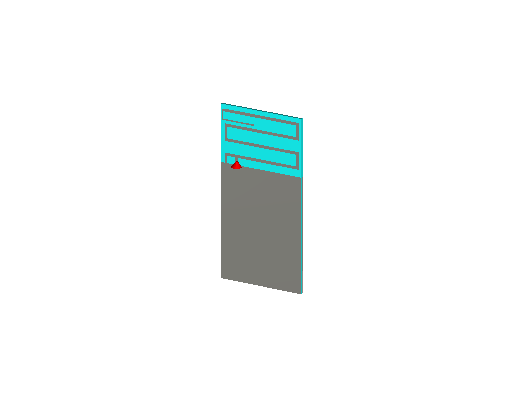
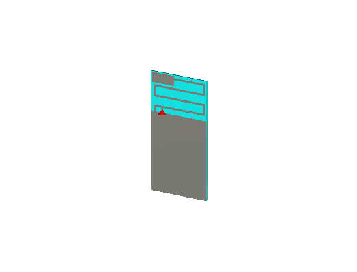
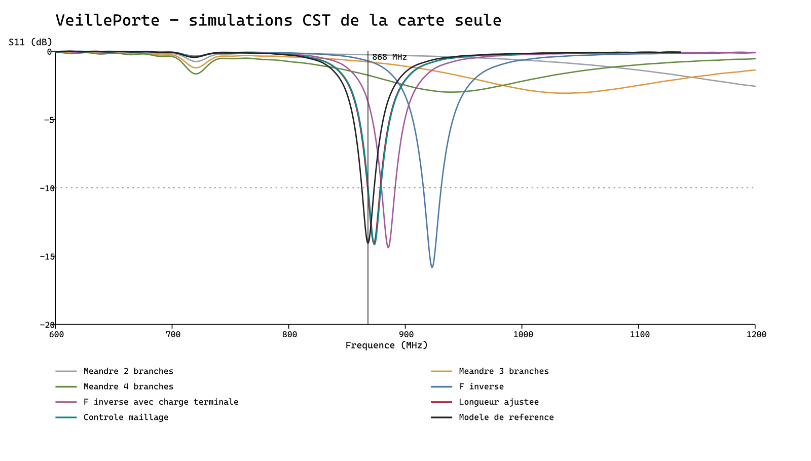

# Antenne VeillePorte — étude CST 868 MHz

Le modèle utilise une carte de 30 × 60 × 0,8 mm et une antenne imprimée en méandre. La variante en F inversé ajoute un court-circuit vers la masse et un point d’alimentation décalé. Une surface terminale permet d’ajuster l’accord. Les calculs CST sont des simulations préliminaires, pas des mesures d’une antenne fabriquée.

## Version active : piste fine sans plaque

Ouvrir **[veilleporte_868_piste_basse.cst](veilleporte_868_piste_basse.cst)**. Le grand rectangle est remplacé par un retour de piste de **0,5 mm** entre les branches, sans surface pleine.

- S11 à 868 MHz : **−12,01 dB** ; minimum vers **865,32 MHz à −13,51 dB**.
- Maillage : **82 620 cellules**, critère d’énergie atteint.
- [Synthèse vérifiable](synthese_piste_fine.json) · [Export CST](s11_veilleporte_868_piste_basse.txt) · [Géométrie](veilleporte_868_piste_basse.vba.txt).



Pour reproduire : `python creer_variante.py --nom nouvel_essai --terminal piste --cap-x 12.3 --right-x 28.67 --retour-y 54.75 --maillage 13`. `cap-x` désigne l’extrémité du retour ; `--terminal plaque` permet de reproduire l’ancienne forme. Le mode par défaut est maintenant `piste`. Le panneau, le boîtier et les pertes cuivre restent à intégrer.

Le moniteur de farfield est réglé à 0,868 GHz dans ce modèle. Pour obtenir le diagramme dans CST, exécuter le solveur du modèle, puis sélectionner `Farfields → farfield (f=0.868)` dans l’arbre et afficher le tracé 3D. Le cache CST contenant les résultats bruts est local et ignoré par Git ; le modèle et sa macro sont versionnés, mais le diagramme n’est pas encore exporté en image ou en fichier texte.

Les valeurs et images de l’ancienne référence ci-dessous concernent la variante avec plaque, conservée pour comparaison.

## Ancienne référence avec plaque — comparaison

Ancien modèle : **[veilleporte_868_reference.cst](veilleporte_868_reference.cst)** dans CST Studio Suite 2026. Le fichier préexistant d’Amira n’est pas remplacé.

| Résultat CST, carte seule | Valeur |
|---|---|
| Minimum échantillonné de S11 | 868,000 MHz |
| S11 à 868 MHz | −14,07 dB |
| Intervalle des points sous −10 dB | Environ 863,18 à 872,82 MHz |
| Cellules du modèle de référence | 81 000 |
| Solveur | Critère d’énergie −40 dB atteint |

Ces résultats concernent le conducteur PEC et le FR4 supposé. La [synthèse vérifiable](synthese_cst.json) conserve les paramètres, les nombres de cellules et les empreintes des fichiers natifs et des exports.





Pour une géométrie de contrôle identique, le passage de 76 440 à 79 380 cellules décale le minimum d’environ 0,536 MHz. Ce contrôle limité ne démontre pas une convergence complète. Un essai à maillage plus fin a été refusé par la licence au-delà de 100 000 cellules.

Les paramètres retenus sont `x_left = 2`, `x_right = x_end = 28,67`, `x_feed = 6`, et les quatre niveaux `y = 43, 48, 53, 58` mm. La charge terminale occupe `x = 0,5…12,3` et `y = 54,5…59,5` mm. [Commandes géométriques du modèle](veilleporte_868_reference.vba.txt).

## Géométrie et excitation

| Élément | Hypothèse de départ |
|---|---|
| PCB | 30 × 60 mm, épaisseur 0,8 mm |
| Substrat | FR4 simplifié, εr = 4,3 ; tan δ = 0,02 |
| Masse | Deux faces sur les 40 premiers millimètres de longueur |
| Zone rayonnante | 30 × 20 mm au bout du PCB, sans masse sous le radiateur |
| Piste | 1 mm, épaisseur géométrique 35 µm |
| Conducteur | PEC pour cette première étude, sans pertes ohmiques |
| Source | Port discret de 50 Ω dans un entrefer de 0,5 mm |
| Limites | Ouvertes avec espace ajouté, six faces |
| Solveur | Temporel ; extinction de l’énergie réglée à −40 dB |
| Moniteur | Champ lointain à 0,868 GHz |

Le port de 50 Ω est une référence d’excitation : il ne remplace pas le calcul de la ligne RF et de son raccordement au RAK3172. Le pont de masse entre les faces est simplifié. L’électronique, les connecteurs et la source réelle ne sont pas détaillés dans ces modèles.

## Panneau et boîtier

Amira indique un panneau d’environ 50 × 50 mm avec deux fils et une intégration dans un boîtier. Le [croquis d’implantation](implantation_proposee.svg) propose de décaler le panneau de la zone antenne. La face du boîtier devra accueillir ce panneau, plus large que le PCB de 30 mm ; un ordre de grandeur de 80 × 55 mm est une proposition à étudier, pas une cote mécanique validée.

Le panneau, ses fils, le boîtier, la colle et le support de porte sont absents des premières simulations. Leurs matériaux, positions et distances doivent être définis, puis ajoutés à l’étude. Éviter de placer une surface métallique ou le panneau au-dessus du radiateur. La marge de 5 mm du croquis est une hypothèse initiale, pas une garantie.

## Fichiers

- Les fichiers `.cst` des essais sont des modèles réellement créés avec CST Studio Suite 2026.
- `s11_*.txt` : exports CST, fréquence en GHz et S11 en dB.
- Les fins de ligne des exports sont normalisées en LF pour Git ; les valeurs numériques restent celles de CST.
- `resultats_simulation.json` et `comparaison_s11.svg` : synthèse des exports.
- `creer_variante.py` : génère une macro `.bas` pour un nouvel essai IFA à partir de `geometrie_ifa.vba.txt`.
- Les dossiers de cache et de résultats binaires CST sont exclus de Git ; les exports sélectionnés sont conservés.
- Le fichier préexistant `antenna.cst` d’Amira est laissé intact.

Exemple de génération d’une nouvelle variante, depuis ce dossier :

```text
python creer_variante.py --nom essai_personnel --cap-x 12.3 --right-x 28.4 --maillage 18
```

La macro contient les chemins absolus de la machine où elle est générée. La régénérer sur un autre ordinateur. Choisir un nouveau nom pour conserver les résultats précédents. La macro crée le modèle et lance le solveur lorsqu’elle est exécutée par CST ; Python seul ne réalise aucune simulation.

## Critères de lecture

L’objectif de réglage initial est un S11 inférieur à −10 dB autour de 868 MHz. Vérifier la fréquence exacte, la bande obtenue et la sensibilité au maillage. Un S11 faible ne prouve ni un bon rendement ni une bonne portée. Les pertes cuivre, le gain réalisé et la situation d’installation doivent encore être étudiés, puis comparés à des mesures au VNA.

L’intégration dans KiCad nécessitera de réserver les 30 × 20 mm de zone antenne et de revoir le placement des composants. Aucun PCB n’a été modifié dans cette étape CST.

Sources de principes : [TI DN023 — antenne en F inversé et influence du plan de masse](https://www.ti.com/lit/an/swra228c/swra228c.pdf), [TI AN058 — choix et intégration des antennes](https://www.ti.com/lit/an/swra161b/swra161b.pdf). Cette géométrie est une proposition spécifique au projet, pas une copie prétendue équivalente des performances TI.
