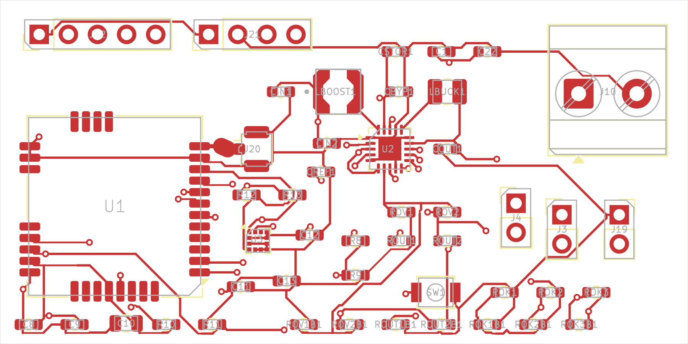
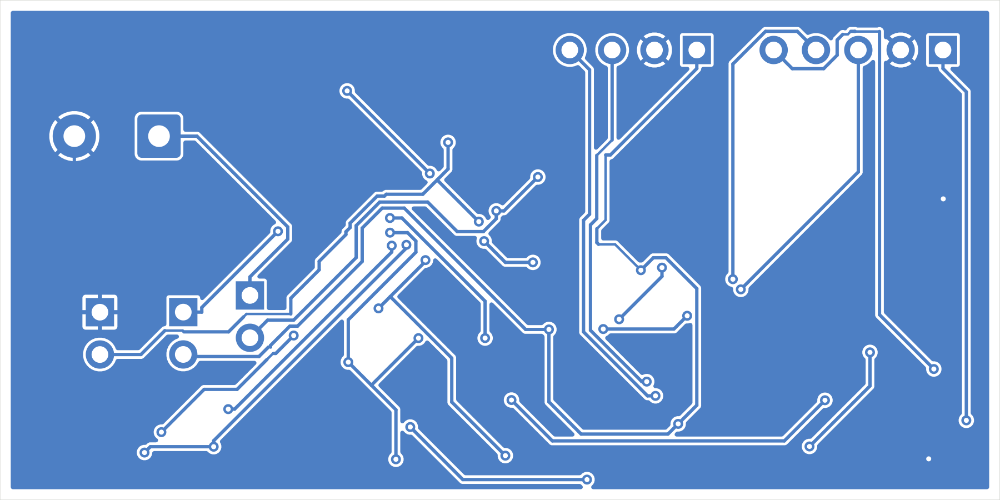
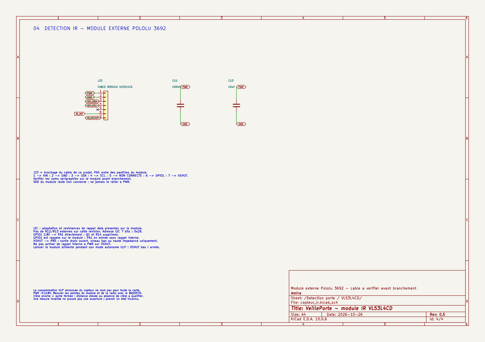
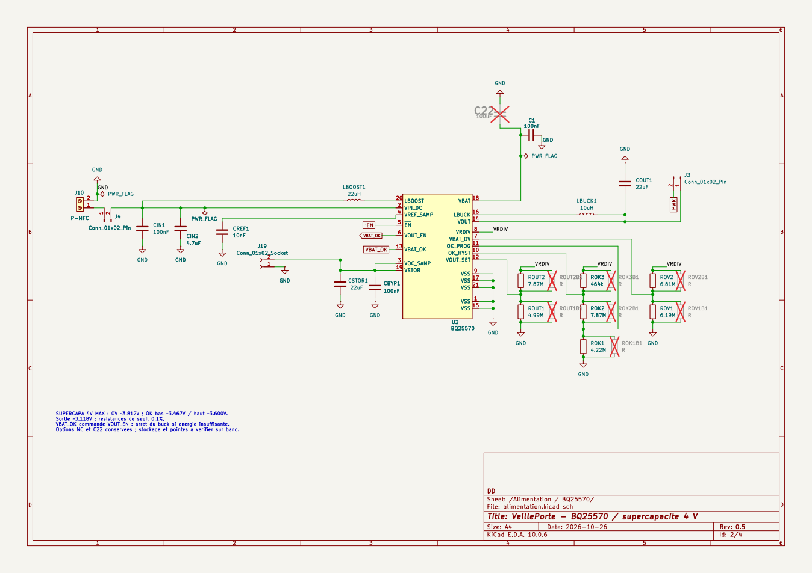

> Révision IR : les vues PCB ci-dessous sont historiques (avant IR). Le nouveau schéma utilise le module VL53L4CD.

# Galerie des schémas

[Accueil](../README.md) · [PDF complet](../VeillePorte/veilleporte.pdf)

Images issues des exports KiCad actuels. Elles montrent les fichiers de conception, pas une carte fabriquée.

## PCB routé — 60 × 30 mm

[Ouvrir le PCB](../VeillePorte/archive_avant_ir/veilleporte.kicad_pcb) · [Lire les contrôles et les hypothèses](../VeillePorte/PCB.md).

## RAK3172 et antenne générique 868 MHz

[Feuille RAK3172](../VeillePorte/rak3172.kicad_sch).

## Accélération — VL53L4CD

[Feuille capteur IR](../VeillePorte/capteur_ir.kicad_sch).

## Alimentation — BQ25570 — supercapacité 4 V

[Feuille BQ25570](../VeillePorte/alimentation.kicad_sch), adaptée aux seuils de la supercapacité 4 V.
